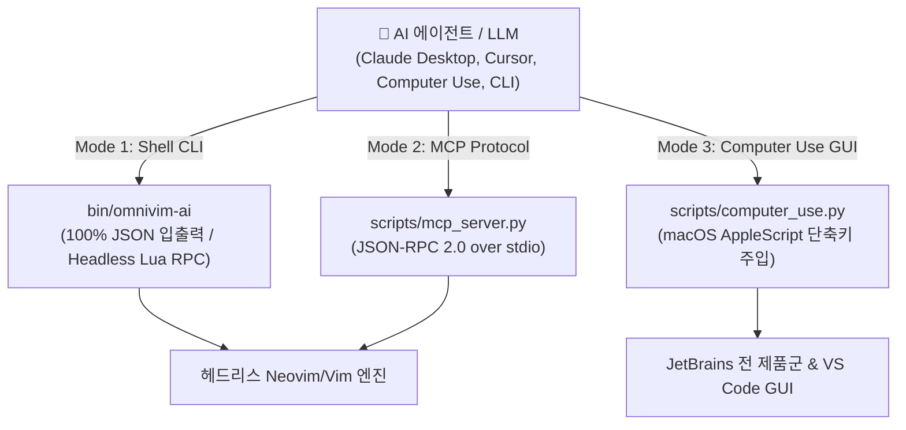

# 🤖 OmniVim AI Agent & Computer Use 인터페이스 명세서

> **Quick Links**: [🏠 README (홈)](README.md) • [🚀 Practice Guide (실습 가이드)](PRACTICE_GUIDE.md) • [🏗️ Architecture (아키텍처 설계서)](PROJECT_STRUCTURE.md) • [⌨️ Hands-On Practice (단축키 실전 훈련)](JETBRAINS_VIM_KEYMAP_PRACTICE.md) • [🗺️ 144 Tips Map (144 팁 색인)](PRACTICAL_VIM_MAP.md) • [🤖 AI Agent Interface (AI 에이전트 인터페이스)](AI_AGENT_INTERFACE.md)

---

> 본 문서는 LLM 및 시각 기반 AI Agent (Claude Desktop, Cursor, OpenAI Operator, Anthropic Computer Use 등)가 OmniVim 환경을 프로그래밍 방식으로 조작하고 검증할 수 있도록 설계된 인터페이스 명세서입니다.  
> 터미널 기반 CLI, Anthropic 공식 표준 **Model Context Protocol (모델 컨텍스트 프로토콜)** 서버, macOS **Computer Use GUI 자동화 브리지**의 3계층 연동 아키텍처를 제공합니다.

---

## 1. 아키텍처 개요 및 3계층 연동 모드

기존 AI 코딩 에이전트는 복잡한 IDE 메뉴의 좌표를 시각적으로 추정하여 클릭하거나, 터미널 환경에서 이스케이프 시퀀스 제어의 한계로 인해 안정적인 편집을 수행하기 어려웠습니다. OmniVim은 이러한 문제를 해결하기 위해 목적과 실행 환경에 맞춘 3가지 연동 인터페이스를 제공합니다:



### 연동 모드별 특성 비교
| 계층 | 모드 명칭 | 주 실행 주체 | 통신 규격 | 핵심 사용 사례 |
|---|---|---|---|---|
| **Mode 1** | **CLI Interface (CLI 인터페이스)** | Terminal Agent (Claude Code, Aider, bash 스크립트 등) | CLI 플래그 및 JSON 스트림 | 헤드리스 환경에서 대규모 일괄 편집 및 144개 실습 자율 채점 |
| **Mode 2** | **MCP Server (MCP 표준 서버)** | Tool Calling 지원 LLM (Claude Desktop, Cursor 등) | JSON-RPC 2.0 (stdio) | 실시간 대화 중 실습 메타데이터 조회, 키 주입, 코드 수정 |
| **Mode 3** | **Computer Use GUI Bridge (GUI 브리지)**| Vision (시각) 기반 OS 조작 에이전트 | macOS AppleScript System Events | 마우스 좌표 추정 없이 활성 IDE 창에 단일 컴파일/실행 단축키 직접 주입 |

---

## 2. Mode 1: AI CLI 인터페이스 (`bin/omnivim-ai`)

터미널 기반 자동화 도구 및 에이전트를 위한 CLI 도구입니다. `--json` 플래그를 통해 모든 출력을 기계 가독형 JSON 포맷으로 수신할 수 있습니다.

### 2.1 실습 메타데이터 및 진행 상황 조회
```bash
# 전체 144개 팁의 메타데이터 및 완료 상태를 JSON 배열로 조회
./bin/omnivim-ai tips --json

# 특정 챕터(예: Normal Mode) 필터링 조회
./bin/omnivim-ai tips --chapter "Normal Mode" --json

# 특정 팁의 문제 설명, 개념, 시작 코드, 기대 정답 상세 조회
./bin/omnivim-ai tip 1 --json
```

**JSON 응답 스키마 예시 (`omnivim-ai tip 1 --json`):**
```json
{
  "tip_num": 1,
  "title": "Meet the Dot Command",
  "concept": "마침표(.) 명령어는 직전의 Change (변경 작업)을 그대로 재실행합니다.",
  "mission": "각 줄 끝에 세미콜론(;)을 추가하세요. 첫 행에서 A; 후 j. j. 로 완료하세요.",
  "recommended_keys": ["A", ";", "<Esc>", "j", ".", "j", "."],
  "practice_path": "practice/ch01_the_vim_way/tip01_meet_the_dot_command/practice.js",
  "current_content": "var foo = 1\nvar bar = 'a'\nvar foobar = foo + bar\n",
  "expected_content": "var foo = 1;\nvar bar = 'a';\nvar foobar = foo + bar;\n",
  "completed": false
}
```

### 2.2 Headless Lua RPC (헤드리스 루아 원격 프로시저 호출) 기반 텍스트 조작
에이전트가 로컬 소스 파일에 대해 복잡한 정규식 치환을 직접 작성하지 않고도, Neovim 내장 Lua API(`nvim_feedkeys`)를 통해 Deterministic (결정론적)으로 편집을 수행할 수 있습니다:
```bash
# 임의의 대상 파일에 Vim 키스트로크를 주입하여 저장
./bin/omnivim-ai exec --file /path/to/source.js --keys "wciwreplacement<Esc>" --json
```

### 2.3 자율 실습 풀이 및 자동 채점 파이프라인
```bash
# AI가 도출한 키 시퀀스를 실습 파일에 주입하고 기대 정답과의 일치 여부 자동 판정
./bin/omnivim-ai solve 1 --keys "A;<Esc>j.j." --json

# 현재 실습 상태 채점 결과 및 Unified Diff 조회
./bin/omnivim-ai check 1 --json

# 실습 파일을 초기 원본 상태로 복구
./bin/omnivim-ai reset 1 --json
```

---

## 3. Mode 2: Anthropic 표준 Model Context Protocol (모델 컨텍스트 프로토콜) 서버

Anthropic이 제정한 개방형 표준 프로토콜인 **Model Context Protocol (모델 컨텍스트 프로토콜)**을 준수하는 stdio 기반 JSON-RPC 2.0 서버를 제공합니다.

### 3.1 Claude Desktop 설정
`~/Library/Application Support/Claude/claude_desktop_config.json` 환경 설정 파일에 OmniVim 서버를 등록합니다:

```json
{
  "mcpServers": {
    "omnivim": {
      "command": "python3",
      "args": [
        "<path-to-omnivim>/scripts/mcp_server.py"
      ]
    }
  }
}
```

### 3.2 Tools (제공 도구) 규격 명세
| 도구 식별자 | 설명 | Input Parameters (JSON Schema 매개변수) |
|---|---|---|
| `omnivim_list_tips` | 144개 OmniVim 팁 목록 및 완료 여부 조회 | `chapter` (문자열, 선택), `keyword` (문자열, 선택) |
| `omnivim_get_tip` | 특정 팁의 개념 설명, 실습 코드, 기대 정답 조회 | `tip_id` (정수, 필수: 1~144) |
| `omnivim_solve_tip` | 키스트로크를 주입하여 실습을 수행하고 채점 결과 반환 | `tip_id` (정수, 필수), `keystrokes` (문자열, 선택) |
| `omnivim_apply_vim_keys` | 임의의 로컬 텍스트 파일에 헤드리스 Vim 조작 실행 | `file_path` (문자열, 필수), `keystrokes` (문자열, 필수) |
| `omnivim_trigger_gui_action`| 활성 IDE 창에 OS 레벨 표준 단축키 주입 | `action` (문자열, 필수), `target_app` (문자열, 선택) |
| `omnivim_get_unified_keymap`| 전 IDE 일원화 단축키 매핑 테이블 조회 | 없음 |

---

## 4. Mode 3: Computer Use GUI 자동화 브리지

Anthropic "Computer Use"를 비롯한 시각 인식 기반 에이전트가 IDE를 제어할 때, **화면상의 작은 아이콘이나 메뉴 좌표를 추정하여 마우스로 클릭하는 과정에서 발생하는 오류율을 근본적으로 제거**합니다. OmniVim의 일원화된 단축키를 macOS System Events 레벨에서 대상 애플리케이션으로 직접 주입합니다.

### 4.1 CLI 지원 액션 목록
```bash
# 현재 활성 IDE 창에서 "단일 파일 컴파일" 실행 (`Cmd+Shift+F9`)
./bin/omnivim-ai gui compile

# "현재 위치 단일 테스트/클래스 실행" (Ctrl+Shift+R)
./bin/omnivim-ai gui run-test

# "현재 위치 단일 테스트/클래스 디버깅" (Ctrl+Shift+D)
./bin/omnivim-ai gui debug

# 도구창/탐색기에서 "에디터로 포커스 복귀" (Escape)
./bin/omnivim-ai gui focus-editor

# "프로젝트 파일 탐색기 열기" (Cmd+1)
./bin/omnivim-ai gui explorer

# "코드 표준 자동 정렬" (Cmd+Alt+L)
./bin/omnivim-ai gui format

# "심볼 이름 일괄 변경 리팩터링" (Shift+F6)
./bin/omnivim-ai gui rename

# "어디서나 전체 검색" (Double Shift / Cmd+Space)
./bin/omnivim-ai gui search-everywhere
```

### 4.2 타깃 애플리케이션 지정 실행
특정 IDE 창을 명시적으로 활성화한 후 단축키를 주입할 수 있습니다:
```bash
./bin/omnivim-ai gui compile --app "CLion"
./bin/omnivim-ai gui run-test --app "IntelliJ IDEA"
./bin/omnivim-ai gui format --app "Code"
```

---

## 5. Self-Learning Loop (자율 학습 루프) 파이프라인

본 인터페이스를 결합하면 AI 에이전트가 외부 인간의 개입 없이 **시작 코드를 분석하고, 최적의 Vim 조작 시퀀스를 생성하며, 실행 결과를 채점하여 피드백을 반영하는 Self-Learning Loop (자율 학습 루프)**를 구성할 수 있습니다.

```python
import subprocess
import json

def autonomous_vim_learner(tip_id: int):
    # Step 1: 팁 메타데이터, 시작 코드, 목표 정답 조회
    proc_info = subprocess.run(
        ["./bin/omnivim-ai", "tip", str(tip_id), "--json"],
        capture_output=True, text=True, check=True
    )
    tip_data = json.loads(proc_info.stdout)
    print(f"[*] Tip {tip_id}: {tip_data['title']} 실습 시작")

    # Step 2: LLM 모델이 시작 코드와 목표 코드를 비교 분석하여 최소 키스트로크 도출
    # 예시 키 시퀀스: "A;<Esc>j.j."
    candidate_keys = "A;<Esc>j.j."

    # Step 3: 헤드리스 엔진에 키스트로크 주입 및 자동 채점
    proc_solve = subprocess.run(
        ["./bin/omnivim-ai", "solve", str(tip_id), "--keys", candidate_keys, "--json"],
        capture_output=True, text=True, check=True
    )
    result = json.loads(proc_solve.stdout)

    if result.get("passed"):
        print(f"[✓] Tip {tip_id} 자율 풀이 성공: Unified Diff 일치율 100%")
    else:
        print(f"[✗] 검증 실패 - Unified Diff:\n{result.get('diff')}")
        # 실패 시 Diff 정보를 다시 프롬프트에 포함하여 재시도 루프 수행

if __name__ == "__main__":
    autonomous_vim_learner(1)
```

이와 같이 OmniVim은 인간 개발자의 학습 도구를 넘어, **차세대 AI 코딩 에이전트가 결정론적이고 안전하게 IDE 환경과 텍스트 버퍼를 제어할 수 있는 표준화된 플랫폼**을 제공합니다.
