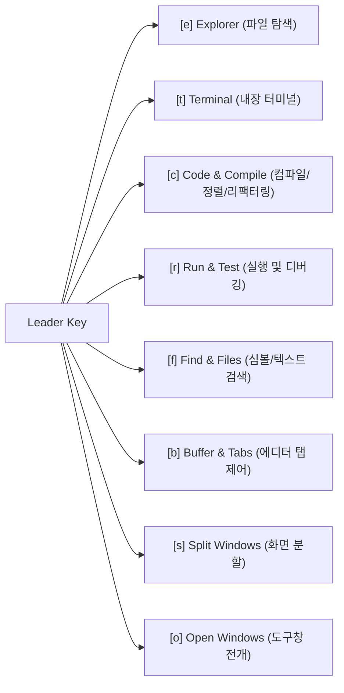

# ⌨️ OmniVim 크로스 IDE 통합 단축키 실무 훈련 가이드

> **Quick Links**: [🏠 README (홈)](README.md) • [🚀 Practice Guide (실습 가이드)](PRACTICE_GUIDE.md) • [🏗️ Architecture (아키텍처 설계서)](PROJECT_STRUCTURE.md) • [⌨️ Hands-On Practice (단축키 실전 훈련)](JETBRAINS_VIM_KEYMAP_PRACTICE.md) • [🗺️ 144 Tips Map (144 팁 색인)](PRACTICAL_VIM_MAP.md) • [🤖 AI Agent Interface (AI 에이전트 인터페이스)](AI_AGENT_INTERFACE.md)

---

> 본 문서는 Google Korea (구글 코리아), Samsung Electronics (삼성전자 DX/DS부문), LG CNS, LG CTO 랩실, SK C&C (SK주식회사 C&C) 등 대규모 엔터프라이즈 환경의 실무 개발 패턴을 기반으로 설계되었습니다.  
> JetBrains IDEs (CLion, IntelliJ IDEA, PyCharm, DataGrip, WebStorm, GoLand, RustRover, DataSpell) 및 Visual Studio Code에서 공통으로 동작하는 OmniVim 단축키 체계를 다룹니다.  
> 마우스 의존도를 낮추고 Context Switching Overhead (컨텍스트 스위칭 오버헤드)를 최소화할 수 있도록, 10가지 핵심 Hands-On Scenarios (실무 시나리오)와 기능별 상세 레퍼런스를 체계적으로 구성했습니다.

---

## 🎯 목차
1. [Mnemonic System (니모닉 연상 체계) 설계 원칙](#1-mnemonic-system-니모닉-연상-체계-설계-원칙)
2. [실무 시나리오 기반 10대 핵심 조작 훈련](#2-실무-시나리오-기반-10대-핵심-조작-훈련)
3. [도구창 및 에디터 포커스 제어 레퍼런스](#3-도구창-및-에디터-포커스-제어-레퍼런스)
4. [컴파일, 빌드 및 실행/디버깅 레퍼런스](#4-컴파일-빌드-및-실행디버깅-레퍼런스)
5. [코드 네비게이션 및 심볼 추적 레퍼런스](#5-코드-네비게이션-및-심볼-추적-레퍼런스)
6. [코드 리팩터링 및 편집 플러그인 레퍼런스](#6-코드-리팩터링-및-편집-플러그인-레퍼런스)

---

## 1. Mnemonic System (니모닉 연상 체계) 설계 원칙

OmniVim의 리더키(`<Space>`) 체계는 무작위 키 배정이 아닌, 기능의 **Mnemonic (영문 첫 글자 약어)**를 기반으로 계층화되어 있습니다. 직관적인 연상 규칙을 적용하여 별도의 암기 부담 없이 조작 방식을 유추할 수 있도록 설계되었습니다.

* **`<Space>e` 계열**: **E**xplorer (프로젝트 파일 탐색기)
  * `e`  : 탐색기 창 열기 및 포커스 이동
  * `ee` : 현재 편집 중인 파일의 트리 위치 자동 전개 (**E**xplore **E**lement)
  * `ea` : 에디터 이전 편집 위치로 포커스 복귀 (**E**ditor **A**ctivate)
* **`<Space>c` 계열**: **C**ode & **C**ompile (코드 수정 및 컴파일)
  * `cc` : 현재 활성 파일 단일 컴파일 (**C**ompile **C**urrent file)
  * `cp` : 프로젝트 전체 빌드 (**C**ompile **P**roject)
  * `cf` : Code Formatting (코드 스타일 표준 자동 정렬)
  * `cr` : Rename Refactoring (심볼 이름 일괄 변경)
  * `ca` : Intention Actions (인텐션 액션 및 빠른 수정)
  * `co` : Optimize Imports (미사용 임포트 정리)
* **`<Space>r` 계열**: **R**un & Test (실행 및 디버깅)
  * `rc` : 커서 위치의 파일/테스트 단일 실행 (**R**un **C**urrent class/test)
  * `dc` : 커서 위치의 파일/테스트 단일 디버깅 (**D**ebug **C**urrent class/test)
  * `rr` : 직전 실행 설정 재실행 (**R**e-**R**un)
  * `rd` : 직전 디버그 설정 재실행 (**R**un **D**ebug)
  * `rs` : 실행 중인 백그라운드 프로세스 중단 (**R**un **S**top)
* **`<Space>o` 계열**: **O**pen Tool Windows (도구창 전개)
  * `or` : 실행 결과 콘솔창 토글 (**O**pen **R**un)
  * `od` : 디버그 세션 및 변수 조사창 토글 (**O**pen **D**ebug)
  * `op` : 프로젝트 에러/경고 진단 목록창 토글 (**O**pen **P**roblems)
  * `os` : 파일 구조 아웃라인창 토글 (**O**pen **S**tructure)

---

## 2. 실무 시나리오 기반 10대 핵심 조작 훈련

개발 현장에서 매일 반복되는 10가지 대표 작업 흐름을 선정하여, 단계별 키 입력 시퀀스와 동작 원리를 정리했습니다.

---

### 시나리오 01: 프로젝트 탐색기와 에디터 간 포커스 전환 및 현재 파일 추적
* **배경**: 코드 편집 중 프로젝트 트리 구조를 확인하거나 주변 설정 파일을 탐색한 뒤, 마우스 조작 없이 즉시 원래 편집 지점으로 복귀해야 하는 상황입니다.
* **조작 시퀀스**:
  1. `<Space>e` 입력: 좌측 프로젝트 탐색기 도구창(`ActivateProjectToolWindow`)이 열리며 포커스가 이동합니다.
  2. `<Space>ee` 입력: Scroll from Source (`SelectInProjectView`)가 동작하여 현재 활성 파일의 위치가 탐색기 트리에서 하이라이트됩니다.
  3. `Esc` (또는 `<Space>ea`) 입력: 도구창을 닫지 않고도 이전 커서 위치의 에디터로 포커스만 즉시 복귀합니다(`FocusEditor`).
* **핵심 가치**: 마우스로 에디터 본문을 다시 클릭하는 번거로움 없이, 키보드만으로 탐색기와 코드 간을 왕복할 수 있습니다.

---

### 시나리오 02: 현재 활성 파일 대상 단일 컴파일 및 Diagnostics (진단 라인) 순회
* **배경**: 모듈이 크고 의존성이 복잡한 프로젝트에서 전체 빌드를 실행하면 수십 초 이상이 소요됩니다. 현재 수정한 단일 소스 파일만 즉각 컴파일하여 문법 에러 유무를 빠르게 검증해야 하는 상황입니다.
* **조작 시퀀스**:
  1. `<Space>cc` (또는 `⌘⇧F9`) 입력: 현재 열린 단일 파일에 대해서만 독립 컴파일(`CompileDirty`)을 수행합니다.
  2. 컴파일 경고 또는 에러가 발생한 경우 `]d` 를 입력하여 다음 에러 위치로 즉시 커서를 이동합니다.
  3. `[d` 를 입력하여 이전 에러 위치로 역방향 점프합니다.
* **핵심 가치**: 전체 빌드 대기 시간을 획기적으로 줄여 빠른 피드백 루프를 유지할 수 있습니다.

---

### 시나리오 03: 커서 위치의 단일 테스트 메서드 및 클래스 격리 실행/디버깅
* **배경**: 전체 단위 테스트 스위트를 구동하지 않고, 현재 작성 또는 수정 중인 특정 테스트 케이스나 main 메서드만 단독으로 검증하려는 상황입니다.
* **조작 시퀀스**:
  1. 실행할 테스트 메서드 또는 클래스 선언 블록 내부에 커서를 위치시킵니다.
  2. `<Space>rc` (또는 `⌃⇧R`) 입력: 해당 타깃만을 격리 실행하는 런너(`RunClass`)가 기동됩니다.
  3. Breakpoint (중단점) 디버깅이 필요할 경우 `<Space>dc` (또는 `⌃⇧D`) 를 입력하여 디버그 모드로 구동합니다.
  4. 실행 결과 확인 후 `Esc` 를 입력하여 작업 중이던 코드로 복귀합니다.
* **핵심 가치**: TDD 및 단위 디버깅 과정에서 불필요한 테스트 실행을 배제하고 단일 맥락에 집중할 수 있습니다.

---

### 시나리오 04: 내장 터미널 토글 및 컨텍스트 보존 에디터 복귀
* **배경**: Git CLI 명령어 실행, 패키지 설치, curl 호출 등 일시적인 쉘 작업이 필요한 상황입니다.
* **조작 시퀀스**:
  1. `<Space>t` (또는 `⌥F12`) 입력: 하단 내장 터미널 창(`ActivateTerminalToolWindow`)이 열리며 포커스가 전환됩니다.
  2. 필요한 터미널 명령어를 입력하고 실행합니다.
  3. 다시 `<Space>t` 를 누르면 터미널 창이 접히며 에디터로 복귀합니다. 터미널 창을 유지한 채 에디터로만 이동하려면 `Esc` 를 입력합니다.
* **핵심 가치**: 별도의 독립 터미널 애플리케이션으로 창을 전환하지 않고 IDE 내부에서 CLI 워크플로우를 완결합니다.

---

### 시나리오 05: 코드 심볼 탐색(선언, 구현, 참조) 및 Jump List (점프 리스트) 복귀
* **배경**: 인터페이스, 호출부, 선언부를 넘나들며 복잡한 코드베이스를 파악한 후, 최초의 작업 지점으로 안정적으로 돌아와야 하는 상황입니다.
* **조작 시퀀스**:
  1. 심볼 위에서 `gd` (또는 `⌘B`) 입력: 함수나 변수의 선언부(`GotoDeclaration`)로 이동합니다.
  2. 인터페이스인 경우 `gi` (또는 `⌘⌥B`) 입력: 실제 오버라이드된 구현체(`GotoImplementation`)로 이동합니다.
  3. `gr` (또는 `⌥F7`) 입력: Find Usages (`FindUsages`)를 실행하여 해당 심볼이 참조되는 프로젝트 내 모든 호출 목록을 확인합니다.
  4. 탐색을 마친 뒤 `<C-o>` 를 반복 입력: Jump List (점프 리스트)를 거슬러 올라가 최초 작업 지점으로 완벽히 복귀합니다.
* **핵심 가치**: 깊은 심볼 탐색 후에도 커서 위치를 잃지 않고 원래 흐름을 유지할 수 있습니다.

---

### 시나리오 06: 3단계 인라인 리팩터링 (이름 변경, 인텐션 액션, 코드 포맷팅)
* **배경**: 구현 중 식별자 명칭을 개선하고, IDE가 제안하는 정적 분석 개선안을 적용한 뒤 코드 서식을 표준화하는 리팩터링 작업입니다.
* **조작 시퀀스**:
  1. 대상 심볼 위에서 `<Space>cr` (또는 `⇧F6`) 입력: Rename Refactoring (심볼 이름 변경) 창(`RenameElement`)을 엽니다.
  2. 새 이름을 입력하고 `Enter`를 누르면 프로젝트 전역 참조가 일괄 변경됩니다.
  3. 경고 밑줄이 표시된 라인에서 `<Space>ca` (또는 `⌥Enter`) 입력: Intention Actions (스마트 인텐션 액션) 메뉴(`ShowIntentionActions`)를 띄워 개선안을 적용합니다.
  4. `<Space>cf` (또는 `⌘⌥L`) 입력: 현재 파일의 서식을 Code Formatting (코드 자동 정렬) 규칙(`ReformatCode`)에 맞추어 정리합니다.
* **핵심 가치**: 코드 품질 개선 작업을 키보드 조작만으로 연속적이고 안전하게 완결할 수 있습니다.

---

### 시나리오 07: 에디터 Vertical Split (수직 창 분할) 및 방향키 기반 포커스 탐색
* **배경**: 인터페이스와 구현체, 또는 소스 코드와 단위 테스트 파일을 좌우에 나란히 배치하고 비교하며 편집하는 상황입니다.
* **조작 시퀀스**:
  1. `<Space>sv` 입력: 현재 활성 에디터를 좌우 수직으로 분할(`SplitVertically`)합니다.
  2. `<C-l>` 입력: 포커스를 우측 분할 창으로 이동합니다.
  3. 우측 창에서 `<Space>ff` 로 대상 파일을 검색하여 오픈합니다.
  4. `<C-h>` 입력: 좌측 에디터로 다시 포커스를 전환합니다.
  5. 창 정리가 완료되면 불필요한 분할 창에서 `<Space>sc` 를 눌러 해당 분할을 닫습니다.
* **핵심 가치**: 표준 Vim 방향키(`h`, `j`, `k`, `l`)와 결합된 `<C-h/j/k/l>`로 다중 에디터 간 전환을 직관적으로 제어합니다.

---

### 시나리오 08: `vim-surround`를 활용한 Delimiter (구분자) 및 Text Objects (텍스트 객체) 제어
* **배경**: 문자열 리터럴의 따옴표 형식을 변경하거나(`"..."` ➔ `'...'`), 특정 표현식을 소괄호나 대괄호로 감싸야 하는 편집 상황입니다.
* **조작 시퀀스**:
  1. `"hello world"` 내부에서 `cs"'` 입력: 큰따옴표가 작은따옴표 `'hello world'` 로 즉시 치환됩니다.
  2. `ds'` 입력: 작은따옴표가 제거되어 순수 텍스트 `hello world` 가 남습니다.
  3. 단어 위에서 `ysiw]` 입력: 해당 단어가 대괄호로 감싸져 `[hello] world` 가 됩니다.
  4. `ysiw)` 입력: 바깥쪽에 소괄호가 추가되어 `([hello]) world` 로 감싸집니다.
* **핵심 가치**: 커서를 문장 앞뒤로 이동해 수동으로 따옴표를 지우고 쓰는 비효율을 완전히 제거합니다.

---

### 시나리오 09: `replaceWithRegister`를 활용한 Unnamed Register (무명 레지스터) 보존 텍스트 치환
* **배경**: A 단어를 복사해 두고 B 단어를 삭제하며 A로 대체하고자 할 때, 일반 `d`나 `c` 명령어를 사용하면 B가 Unnamed Register (무명 레지스터)에 덮어씌워져 이전에 복사한 내용이 유실되는 문제가 발생합니다.
* **조작 시퀀스**:
  1. 복사할 단어 위에서 `yiw` 입력: 해당 단어가 레지스터에 저장됩니다.
  2. 교체 대상 단어로 이동합니다.
  3. `griw` 입력: 대상 단어가 즉시 복사해 둔 단어로 교체되며, Unnamed Register (무명 레지스터)에는 여전히 원래 단어가 보존됩니다.
  4. 다음 대상 단어로 이동하여 반복해서 `griw` 를 입력하면 동일한 단어로 연속 치환할 수 있습니다.
* **핵심 가치**: 레지스터 오염 없이 클립보드 내용을 대상 위치에 안전하게 덮어쓸 수 있습니다.

---

### 시나리오 10: `vim-exchange`를 활용한 인접 식별자 위치 맞교환
* **배경**: 파라미터 순서 변경(`first, second` ➔ `second, first`)이나 연산자 좌우 항의 위치를 서로 바꾸어야 하는 상황입니다.
* **조작 시퀀스**:
  1. `first` 단어 위에서 `cxiw` 입력: 첫 번째 대상 단어가 시각적으로 하이라이트 마킹됩니다.
  2. `second` 단어로 커서를 이동합니다.
  3. 다시 `cxiw` 입력: 두 단어의 위치가 즉시 상호 맞교환됩니다.
* **핵심 가치**: 단어를 잘라내고, 이동하고, 붙여넣는 복합 과정을 단 2회의 직관적인 키 스트로크로 축약합니다.

---

## 3. 도구창 및 에디터 포커스 제어 레퍼런스

| 기능 명칭 | JetBrains macOS | Action ID | 대응 Vim 바인딩 | 동작 설명 및 실무 적용 |
|---|---|---|---|---|
| **프로젝트 탐색기 토글** | `⌘1` | `ActivateProjectToolWindow` | `<Space>e` | 프로젝트 파일 트리 창을 열거나 닫음 |
| **현재 파일 위치 추적** | `⌥F1` ➔ `1` | `SelectInProjectView` | `<Space>ee` | 깊은 디렉터리 경로 내 현재 편집 파일 전개 |
| **에디터 포커스 복귀** | `Esc` | `FocusEditor` | `Esc` 또는 `<Space>ea` | 도구창에 위치한 포커스를 직전 에디터 커서로 이동 |
| **내장 터미널 토글** | `⌥F12` | `ActivateTerminalToolWindow` | `<Space>t` | 내장 쉘 콘솔 창을 열거나 닫음 |
| **Run (실행 콘솔) 토글** | `⌘4` | `ActivateRunToolWindow` | `<Space>or` | 애플리케이션 표준 입출력 및 로그 확인 |
| **Debug (디버그 콘솔) 토글** | `⌘5` | `ActivateDebugToolWindow` | `<Space>od` | 중단점 변수 조사식 및 Stack Trace (스택 트레이스) 확인 |
| **Problems (문제 진단 창)** | `⌘6` | `ActivateProblemsViewToolWindow` | `<Space>op` | 프로젝트 전역 컴파일 에러 및 경고 목록 |
| **Structure (파일 구조 창)** | `⌘7` | `ActivateStructureToolWindow` | `<Space>os` | 현재 파일 내 클래스, 메서드, 필드 아웃라인 |
| **Version Control (Git 버전 관리 창)** | `⌘9` | `ActivateVersionControlToolWindow` | `<Space>gg` | Local Changes (로컬 변경 파일) 및 커밋 로그 |

---

## 4. 컴파일, 빌드 및 실행/디버깅 레퍼런스

| 기능 명칭 | JetBrains macOS | Action ID | 대응 Vim 바인딩 | 동작 상세 |
|---|---|---|---|---|
| **현재 파일 단일 컴파일** | `⌘⇧F9` | `CompileDirty` | `<Space>cc` / `<Space>cb` | 현재 열린 단일 소스 파일만 즉시 컴파일 |
| **프로젝트 전체 빌드** | `⌘F9` | `CompileProject` | `<Space>cp` | 모든 모듈과 종속성을 포함한 프로젝트 전체 빌드 |
| **현재 파일/테스트 실행** | `⌃⇧R` | `RunClass` | `<Space>rc` | 커서 위치의 main() 메서드 또는 단위 테스트 실행 |
| **현재 파일/테스트 디버그**| `⌃⇧D` | `DebugClass` | `<Space>dc` | 커서 위치의 타깃을 디버거 세션으로 기동 |
| **직전 설정 재실행** | `⌃R` | `Run` | `<Space>rr` | 마지막으로 실행했던 타깃을 다시 실행 |
| **직전 설정 재디버그** | `⌃D` | `Debug` | `<Space>rd` | 마지막으로 실행했던 타깃을 다시 디버깅 |
| **실행 프로세스 강제 중단**| `⌘F2` | `Stop` | `<Space>rs` | 무한 루프 또는 백그라운드 프로세스 즉각 종료 |

---

## 5. 코드 네비게이션 및 심볼 추적 레퍼런스

| 기능 명칭 | JetBrains macOS | Action ID | 대응 Vim 바인딩 | 동작 상세 |
|---|---|---|---|---|
| **선언부로 이동** | `⌘B` / `F12` | `GotoDeclaration` | `gd` | 함수나 변수가 최초 선언된 위치로 점프 |
| **타입 선언부로 이동** | `⌘⇧B` | `GotoTypeDeclaration` | `gD` | 대상 변수의 타입(클래스/구조체) 정의로 점프 |
| **구현체로 이동** | `⌘⌥B` | `GotoImplementation` | `gi` | 인터페이스를 오버라이드한 실제 구현 클래스로 점프 |
| **모든 사용처 검색** | `⌥F7` / `⇧F12` | `FindUsages` | `gr` | 프로젝트 전역에서 해당 심볼을 호출하는 위치 조회 |
| **점프 리스트 이전 복귀** | `⌘[` | `Back` | `<C-o>` | Jump List (점프 리스트) 이전 커서 위치로 복귀 |
| **점프 리스트 이후 이동** | `⌘]` | `Forward` | `<C-i>` | 되돌아간 점프 기록을 다시 앞으로 이동 |
| **직전 텍스트 수정 위치** | - | `JumpToLastChange` | `g;` | 마지막으로 텍스트를 편집했던 위치로 즉시 점프 |
| **Quick Documentation** | `F1` | `QuickJavaDoc` | `K` 또는 `gh` | 커서 위치 식별자의 API 문서 및 시그니처 팝업 확인 |
| **다음 / 이전 진단 점프**| `F2` / `⇧F2` | `GotoNextError` / `Prev` | `]d` / `[d` | 파일 내 문법 에러 및 경고 라인 순회 |
| **다음 / 이전 Git 변경점**| `⌥↓` / `⌥↑` | `VcsShowNextChangeMarker` | `]c` / `[c` | Git Hunk (수정 사항) 위치로 순차 점프 |
| **다음 / 이전 메서드 점프**| `⌃↓` / `⌃↑` | `MethodDown` / `MethodUp` | `]m` / `[m` | 함수 선언 단위로 상하 점프 |

---

## 6. 코드 리팩터링 및 편집 플러그인 레퍼런스

| 기능 명칭 | JetBrains macOS | Action ID | 대응 Vim 바인딩 | 동작 상세 |
|---|---|---|---|---|
| **코드 스타일 자동 포맷팅**| `⌘⌥L` | `ReformatCode` | `<Space>cf` | 들여쓰기 및 공백 규칙을 프로젝트 표준으로 자동 정렬 |
| **심볼 일괄 이름 변경** | `⇧F6` | `RenameElement` | `<Space>cr` | Rename Refactoring (식별자 명칭 전역 일괄 변경) |
| **인텐션 액션 / 빠른 수정** | `⌥Enter` | `ShowIntentionActions` | `<Space>ca` | Intention Actions (코드 경고 해결 및 모던 문법 변환 제안) |
| **임포트문 최적화** | `⌃⌥O` | `OptimizeImports` | `<Space>co` | Optimize Imports (미사용 import문 제거 및 정렬) |
| **현재 행 복제** | `⌘D` | `EditorDuplicate` | `yyp` | 현재 커서 라인을 바로 아래 행에 복제 |
| **현재 행 삭제** | `⌘⌫` | `EditorDeleteLine` | `dd` | 현재 커서 라인 전체 삭제 |
| **단일 행 주석 토글** | `⌘/` | `CommentByLineComment` | `gcc` | 현재 행 주석 처리 및 해제 |
| **문단 블록 주석 토글** | `⌘⌥/` | `CommentByBlockComment` | `gcap` | 커서가 속한 문단 블록 전체 주석 토글 |
| **코드 블록 접기/펼치기**| `⌘.` | `ExpandCollapseToggleAction` | `za` | 현재 함수 또는 블록 스코프 Code Folding 토글 |
| **모든 코드 블록 일괄 조작**| `⌘⇧-` / `⌘⇧+` | `CollapseAll` / `ExpandAll` | `zM` / `zR` | 파일 내 모든 폴딩 영역 일괄 접기 / 펼치기 |
| **정수 1 증가 / 감소** | - | - | `<C-a>` / `<C-x>` | 커서 아래 숫자를 1씩 가감 |
| **구분자 변경 및 삭제** | - | Surround | `cs"'` / `ds"` | 큰따옴표를 작은따옴표로 치환하거나 삭제 |
| **단어 구분자 감싸기** | - | Surround | `ysiw]` / `ysiw)` | 단어를 `[]` 또는 `()` 로 둘러싸기 |
| **무명 레지스터 보존 치환**| - | ReplaceWithRegister | `griw` | Unnamed Register 오염 없이 대상 단어를 복사본으로 대체 |
| **두 심볼 위치 맞교환** | - | Exchange | `cxiw` | 선택된 두 텍스트 객체의 위치를 상호 교환 |

---

### 💡 실무 적용 권장 사항
IDE에서 본 가이드 문서를 Vertical Split (수직 창 분할, `<Space>sv`)로 에디터 한쪽에 띄워 둔 상태로 실제 개발을 진행해 보세요.  
각 시나리오의 조작 시퀀스를 실제 작업 흐름에 적용함으로써 도구 조작에 소모되는 Cognitive Load (인지 부하)를 줄이고, 개발 본연의 문제 해결과 비즈니스 로직 구현에 집중할 수 있습니다.
