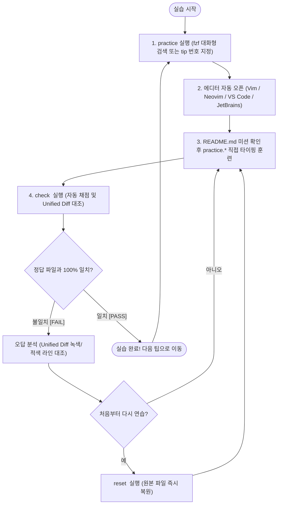

# 🚀 OmniVim 완벽 실습 가이드 (Operational Practice Guide)

> **"개념을 확인하고 ➔ 터미널이나 선호하는 IDE에서 열고 ➔ 직접 손으로 키스트로크를 빚어 타이핑하고 ➔ `check` 스크립트로 0.1초 만에 자동 채점하며 ➔ 언제든 `reset`으로 원본을 복원한다."**  
> *(참조 철학: 《Practical Vim, Second Edition》, Drew Neil)*
>
> 🏠 **홈 & 퀵스타트**: [README.md](README.md)  
> 🏗️ **아키텍처 및 디렉터리 트리 상세 설계서**: [PROJECT_STRUCTURE.md](PROJECT_STRUCTURE.md)  
> 🗺️ **144 팁 전체 색인 및 핵심 명령어 상세 레퍼런스**: [PRACTICAL_VIM_MAP.md](PRACTICAL_VIM_MAP.md)  
> ⌨️ **JetBrains & Vim 10대 실무 타이핑 집중 훈련 가이드**: [JETBRAINS_VIM_KEYMAP_PRACTICE.md](JETBRAINS_VIM_KEYMAP_PRACTICE.md)  
> 🤖 **AI 에이전트 인터페이스 (CLI·MCP·Computer Use)**: [AI_AGENT_INTERFACE.md](AI_AGENT_INTERFACE.md)

---

## 🧭 1. 전체 실습 및 검증 루프 사이클 (Closed-Loop Cycle)

OmniVim의 144개 실습 모듈은 아래의 **[검색/선택 ➔ 에디터 오픈 ➔ 직접 타이핑 ➔ 자동 채점 ➔ 디프 대조/복구]** 폐쇄 루프 사이클로 학습합니다.



### 📋 루프 사이클 핵심 실행 명령 요약표

| 단계 | 실행 명령어 | 판단 및 분기 (Branching) | 다음 액션 |
|:---:|:---|:---|:---|
| **1. 검색/선택** | `practice` 또는 `practice -i` | 144개 목록 중 키워드로 필터링하여 실습 팁 선택 | `Enter` 키로 에디터 자동 오픈 |
| **2. 에디터 오픈** | `practice <번호> [--에디터]` | • 기본값: 터미널 Vim<br/>• `--nvim`, `--code`, `--clion`, `--pycharm`, `--idea` | 해당 에디터에서 실습 파일 오픈 |
| **3. 타이핑 훈련** | `practice.*` 직접 편집 | `README.md`의 목표와 추천 키스트로크를 보며 손으로 직접 수행 | 편집 완료 후 저장 (`:w`) |
| **4. 자동 채점** | `check <번호>` | • **`[ PASS ]` 일치**: 정답 판정 ➔ 5단계로 이동<br/>• **`[ FAIL ]` 불일치**: Unified Diff 출력 확인 | 오답 라인 분석 |
| **5. 원본 초기화** | `reset <번호>` | 실수로 코드가 엉켰거나 다시 처음부터 훈련하고 싶을 때 | 원본 `.original_*` 파일로 0.1초 즉시 복구 |
| **전체 초기화** | `reset --all` | 144개 전체 실습 파일을 최초 상태로 일괄 복원 | 전체 실습 셋 초기화 완료 |

---

## 🔰 2. 초심자를 위한 `practice`, `check`, `reset` 완벽 사용법

> **💡 골든 룰 (가장 흔한 실수 방지)**:  
> 1. `~/.zshrc`에 등록된 전역 명령어(`omnivim`, `practice`, `check`, `reset`)는 **터미널 어느 경로에서나 즉시 실행**할 수 있습니다.  
> 2. 저장소 내부에서 실행할 때도 `./scripts/practice.sh` 대신 그냥 `practice`만 입력하면 됩니다.  
> 3. 인자 없이 `practice`만 치면 **fzf 기반 실시간 TUI 대화형 검색창**이 즉시 열립니다.

### 2.1 대화형 fzf TUI 검색 런처: `practice` (또는 `practice -i`)

터미널에서 `practice`를 입력하면 아래와 같은 분할 검색 창이 열립니다:
* **좌측 목록**: Tip 번호, 제목, 소속 챕터 목록
* **우측 미리보기 창**: 해당 팁의 `README.md` (출처 도서 페이지, 학습 목표, 실습 미션, 권장 키스트로크) 실시간 렌더링

```text
🥋 OmniVim [1-144] > dot_formula
Tip 006 │ Meet the Dot Formula                     │ [The Vim Way]
Tip 001 │ Meet the Dot Command                     │ [The Vim Way]
──────────────────────────────────────────────────────────────────────────
# Tip 6: Meet the Dot Formula
> **출처**: 《Practical Vim, Second Edition》 p. 11
> **챕터**: The Vim Way (ch01_the_vim_way)

## 🎯 Concept (학습 목표)
하나의 키스트로크로 이동하고, 하나의 키스트로크로 변경을 실행합니다.

## ⌨️ Recommended Keystrokes (권장 키스트로크)
1. `var foo = 1;` 라인 끝으로 이동: `$` 또는 `A`
2. 끝에 세미콜론 누락 시 `;` 추가: `A;<Esc>`
3. 다음 줄로 이동 및 마침표 재실행: `j.`
```

* **키보드 조작법**:
  * `↑` / `↓` 또는 `Ctrl+p` / `Ctrl+n`: 팁 항목 위아래 이동
  * `검색어 입력`: 단어 입력 시 실시간 퍼지 필터링 (예: `surround`, `dot`, `substitute`)
  * `Enter`: 선택한 팁의 실습 에디터 즉시 열기
  * `ESC` 또는 `Ctrl+c`: 검색 창 닫고 터미널 복귀

### 2.2 선호하는 IDE / 에디터로 실습 열기

`practice` 명령어 뒤에 원하는 에디터 플래그를 지정하여 바로 열 수 있습니다:

```bash
# 기본 CLI Vim으로 열기
practice 1

# Neovim으로 열기
practice 1 --nvim

# Visual Studio Code로 열기
practice 1 --code

# JetBrains CLion으로 열기
practice 12 --clion

# JetBrains PyCharm으로 열기
practice 85 --pycharm

# JetBrains IntelliJ IDEA로 열기
practice 113 --idea
```

### 2.3 자동 채점기: `check <번호>`

실습 파일(`practice.*`) 수정을 마치고 저장한 뒤, 터미널에서 `check <번호>`를 실행합니다.

#### 🟢 통과했을 때 (`[ PASS ]`):
```text
🔍 Tip 1 채점 중...
   실습 대상: /path/to/omnivim/practice/ch01_the_vim_way/tip01_meet_the_dot_command/practice.js
   기준 정답: /path/to/omnivim/practice/ch01_the_vim_way/tip01_meet_the_dot_command/expected_practice.js

🎉 축하합니다! Tip 1 실습을 완벽하게 통과했습니다! (100% 일치)
```

#### 🔴 실패했을 때 (`[ FAIL ]`):
기대 정답 파일(`expected_*`)과 내 실습 파일의 차이점이 Unified Diff로 출력됩니다.
```text
🔍 Tip 1 채점 중...
❌ [FAIL] 정답 파일과 차이점이 발견되었습니다:
--- /path/to/expected_practice.js
+++ /path/to/practice.js
@@ -1,3 +1,3 @@
-var foo = 1;
-var bar = 2;
+var foo = 1
+var bar = 2
```
* `-` (빨간색): 기대 정답에는 있지만 내 실습 파일에 누락된 내용
* `+` (초록색): 기대 정답에 없는데 내 실습 파일에 잘못 추가된 내용
* 디프를 확인하고 에디터로 돌아가 수정한 뒤 다시 `check 1`을 실행합니다.

### 2.4 실습 원본 복구 도구: `reset <번호>`

연습 중 파일이 지나치게 훼손되었거나, 다음 날 다시 처음부터 타이핑 연습을 하고 싶을 때 사용합니다.

```bash
# 특정 팁 원본 복원 (0.1초 소요)
reset 1

# 전체 144개 팁 원본 일괄 복원
reset --all
```

---

## ⌨️ 3. 에디터별 실무 연동 및 핫 리로드 (Hot Reload) 가이드

OmniVim의 가장 큰 강점은 **어떤 에디터(JetBrains, VS Code, CLI Vim, Neovim)를 띄워도 손가락 기억(Muscle Memory)이 단 1%도 어긋나지 않는 일관성**입니다.

### 3.1 JetBrains IDEs (CLion, PyCharm, IntelliJ, DataGrip, WebStorm)

OmniVim의 마스터 인스톨러(`./install.sh`)를 실행하면 모든 JetBrains IDE에 `Unified Master Keymap`과 `~/.ideavimrc`가 자동 주입됩니다.

#### 1) 무재부팅 핫 리로드 (Hot Reload):
JetBrains IDE를 이미 실행 중인 상태에서 `.ideavimrc` 설정을 변경했거나 새로 적용하려는 경우, IDE를 재부팅할 필요가 없습니다.  
에디터 화면에서 `Normal Mode (일반 모드)` 상태로 다음 명령어를 입력합니다:
```vim
:source ~/.ideavimrc
```
화면 하단에 IdeaVim 설정이 즉시 재로드되며 새로운 단축키와 플러그인이 0.1초 만에 반영됩니다.

#### 2) Mnemonic Leader Key (니모닉 리더키) 실무 단축키:
Leader Key는 `<Space>` (스페이스바)로 일원화되어 있습니다.

| 단축키 | 기능 설명 | 네이티브 매핑 / Action ID |
|---|---|---|
| `<Space>e` | 프로젝트 탐색기 열기 / 포커스 | `⌘1` (`ActivateProjectToolWindow`) |
| `<Space>ee` | 탐색기 트리에서 현재 편집 중인 파일 위치 추적 | `⌥F1, 1` (`SelectInProjectView`) |
| `<Space>w` | 현재 에디터 버퍼 닫기 | `⌘W` (`CloseContent`) |
| `<Space>ff` | 파일명으로 프로젝트 내 파일 빠른 검색 | `⇧⌘O` (`GotoFile`) |
| `<Space>fg` | 프로젝트 전체 텍스트 검색 (Ripgrep 수준 고속) | `⇧⌘F` (`FindInPath`) |
| `<Space>fr` | 최근 열었던 파일 목록 (Recent Files) | `⌘E` (`RecentFiles`) |
| `<Space>fa` | 심볼 / 클래스 / 파일 전체 통합 검색 | `Double Shift` (`SearchEverywhere`) |
| `<Space>cr` | 심볼 이름 일괄 리팩터링 (Rename) | `⇧F6` (`RenameElement`) |
| `<Space>ca` | 빠른 수정 및 인텐션 액션 제안 (Code Action) | `⌥Enter` (`ShowIntentionActions`) |
| `<Space>cf` | 코드 서식 자동 정리 (Format Document) | `⌥⌘L` (`ReformatCode`) |
| `<Space>t` | 내장 터미널 열기 / 닫기 | `⌥F12` (`ActivateTerminalToolWindow`) |
| `<Space>gg` | Git / VCS 도구 창 열기 | `⌘9` (`ActivateVersionControlToolWindow`) |

### 3.2 Visual Studio Code

* `VSCodeVim` 확장이 활성화되어 있으며, `keybindings.json`을 통해 JetBrains와 동일한 리더키 조합을 지원합니다.
* `<Space>e` (탐색기), `<Space>ff` (`workbench.action.quickOpen`), `<Space>cr` (심볼 이름 변경), `<Space>cf` (서식 정리) 등이 완벽히 대칭 동작합니다.

### 3.3 터미널 Vim & Neovim

* **공통 설정 파일**: `~/practical-vim/vimrc_practical.vim` (`configs/practical_vim/vimrc_practical.vim`, Single Source of Truth)
* **CLI Vim**: `~/.vimrc`에서 코어 설정을 로드하고, `vim-plug` 환경이 구성된 경우 NERDTree 및 fzf 매핑(`<leader>e`, `<leader>ff`, `<leader>fg`)을 지원합니다.
* **Neovim**: `~/.config/nvim/lua/config/keymaps.lua`를 통해 동일한 리더키 체계를 네이티브 Lua 매핑으로 제공합니다.

---

## 🤖 4. AI 에이전트 자율 풀이 및 헤드리스 검증

OmniVim은 사람의 실습뿐만 아니라 **AI 에이전트의 자율 문제 해결 및 회귀 테스트 훈련**을 위해 헤드리스 CLI 인터페이스를 기본 내장하고 있습니다.

```bash
# 1. 특정 팁의 메타데이터 및 미션 JSON 형태로 조회
omnivim tip 1 --json

# 2. AI 헤드리스 Vim 엔진으로 특정 팁 자율 풀이 및 채점
omnivim solve 1 --json

# 3. 특정 팁 초기화
omnivim reset 1 --json

# 4. 144개 전체 실습 모듈 전수 자율 풀이 무결성 감사
python3 -c "
import sys
sys.path.insert(0, 'scripts')
from omnivim_ai import OmniVimAI

ai = OmniVimAI()
passed = sum(1 for i in range(1, 145) if ai.solve_tip(i).get('passed'))
print(f'144 Tips Autonomous Solving: {passed}/144 PASSED')
"
```

---

## ❓ 5. 자주 묻는 질문 (FAQ) & 트러블슈팅

### Q1. `practice`나 `check` 명령어를 쳤는데 `command not found`가 뜹니다.
* 새로운 터미널 창을 열거나, 현재 셸에서 `source ~/.zshrc`를 실행하세요.
* `~/.zshrc`에 등록된 `export OMNIVIM_ROOT="$HOME/githubs/omnivim"` 블록이 정상적으로 로드되었는지 확인합니다.

### Q2. JetBrains IDE에서 `<Space>`를 눌러도 탐색기나 검색창이 열리지 않습니다.
* 에디터가 `Insert Mode (삽입 모드)`가 아닌지 확인하세요. 리더키 단축키는 `Normal Mode (일반 모드)`에서 동작합니다.
* IDE 상단 메뉴 `Tools` ➔ `Vim Emulator`에 체크가 켜져 있는지 확인합니다.
* 에디터에서 `:source ~/.ideavimrc`를 입력하여 설정을 다시 로드합니다.

### Q3. 실습 도중 실수로 실습 파일을 완전히 지웠거나 망가뜨렸습니다.
* 당황하지 마시고 터미널에서 `reset <해당 팁 번호>` (예: `reset 12`)를 실행하세요.
* 각 디렉터리에 보관된 숨김 파일(`.original_*`)로부터 0.1초 만에 원본 파일이 복구됩니다.

### Q4. 144개 전체 환경이 정상적으로 배포되었는지 한 번에 점검하고 싶습니다.
* 프로젝트 루트에서 `./verify_all.sh` 또는 `python3 scripts/audit_all.py`를 실행하세요.
* 코어 엔진, IdeaVim, JetBrains 키맵, VS Code 단축키, Vim/Neovim 구문, 144개 실습 파일 무결성까지 81개 항목을 1초 만에 전수 검증합니다.
