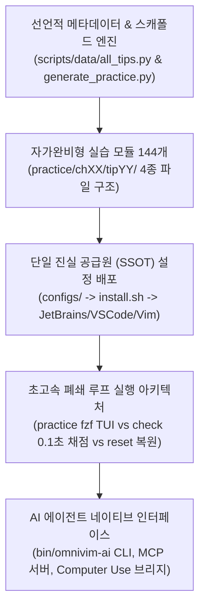
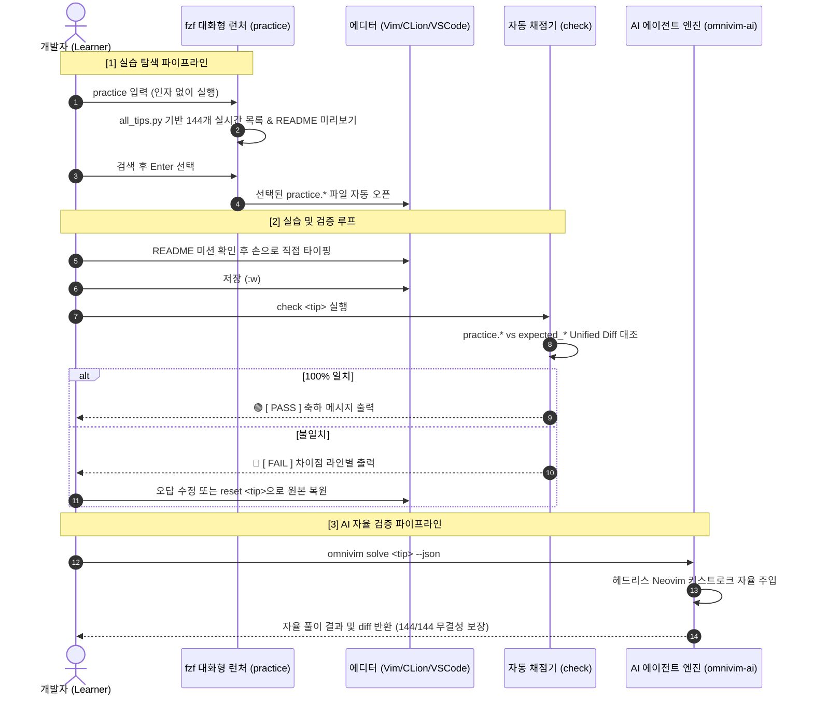

# 🏗️ OmniVim 아키텍처 및 디렉터리 트리 상세 설계서 (Project Structure & Intent)

> **이 문서는 본 프로젝트(`omnivim`)의 전체 디렉터리 구조와 각 컴포넌트의 엔지니어링 설계 의도를 정의한 표준 아키텍처 명세서입니다.**  
> 향후 다른 에디터나 새로운 키맵 학습 트랙, 대규모 실습 프로젝트를 설계할 때도 본 아키텍처 패턴을 그대로 청사진(Blueprint)으로 활용할 수 있도록 작성되었습니다.
>
> 🏠 **홈 & 퀵스타트**: [README.md](README.md)  
> 🚀 **초심자를 위한 완벽 실습 가이드 (5단계 폐쇄 루프 사이클 & IDE 연동)**: [PRACTICE_GUIDE.md](PRACTICE_GUIDE.md)  
> 🗺️ **144 팁 전체 색인 및 핵심 명령어 상세 레퍼런스**: [PRACTICAL_VIM_MAP.md](PRACTICAL_VIM_MAP.md)  
> ⌨️ **JetBrains & Vim 10대 실무 타이핑 집중 훈련 가이드**: [JETBRAINS_VIM_KEYMAP_PRACTICE.md](JETBRAINS_VIM_KEYMAP_PRACTICE.md)  
> 🤖 **AI 에이전트 인터페이스 (CLI·MCP·Computer Use)**: [AI_AGENT_INTERFACE.md](AI_AGENT_INTERFACE.md)

---

## 1. 핵심 설계 철학 (Architectural Principles)

본 프로젝트는 **"144개의 방대한 실습 코드를 다루면서도 저장소를 깃허브 친화적으로 초경량 유지하고, 크로스 IDE 설정 일관성과 초고속 실습 편의성을 극대화한다"**는 목표 아래 5가지 원칙으로 설계되었습니다.



1. **선언적 메타데이터와 전수 생성 엔진 분리 (Scaffold Engine Pattern)**:
   * 144개에 달하는 `practice.*`, `expected_*`, `README.md`, `.original_*` 파일들을 수작업으로 관리하지 않고, 선언적 메타데이터(`scripts/data/all_tips.py`)를 기반으로 생성 엔진(`generate_practice.py`)이 Idempotent (멱등)하게 일괄 생성/검증합니다.
2. **자가완비형 캡슐화 (Self-Contained Encapsulation)**:
   * 각 실습 항목은 외부 환경이나 인터넷 연결 없이 독자적으로 완결되는 4종 표준 파일(`README.md`, `practice.*`, `expected_*`, `.original_*`)로 구성되어, 오프라인 환경에서도 100% 자가 실습 및 자동 채점이 가능합니다.
3. **단일 진실 공급원 (Single Source of Truth) 기반 크로스 IDE 동기화**:
   * 개별 IDE 프로필에 설정이 파편화되는 문제를 방지하기 위해 `configs/` 디렉터리를 SSOT로 수립하고, `./install.sh` 실행 시 로컬의 모든 JetBrains IDE(20여 개 버전 프로필)와 VS Code, CLI 환경에 동일한 키맵과 플러그인 설정을 원클릭으로 일괄 주입합니다.
4. **초고속 Fast-path 폐쇄 루프 실행 아키텍처**:
   * **대화형 fzf 검색 (`practice` / `practice -i`)**: 144개 팁을 키워드로 실시간 필터링하며 우측 창에서 미션을 확인하고 원하는 에디터로 즉시 오픈.
   * **0.1초 자동 채점 (`check <번호>`)**: 기대 정답과 실습 파일의 차이를 Unified Diff로 0.1초 만에 대조하여 합격 여부 판정.
   * **0.1초 원본 복원 (`reset <번호>`)**: 숨김 백업본(`.original_*`)으로부터 무손실 복구 지원.
5. **에이전트 우선 아키텍처 (Agent-First Architecture)**:
   * 인간 개발자뿐만 아니라 Claude Desktop, Cursor, OpenAI Operator, Anthropic Computer Use 등 최신 AI 코딩 에이전트가 헤드리스 Neovim RPC, MCP JSON-RPC 2.0 stdio, macOS GUI 단축키 주입을 통해 편집 환경을 자율 제어할 수 있도록 기본 설계되었습니다.

---

## 2. 전체 디렉터리 트리 (Visual Directory Tree)

```text
omnivim/
├── README.md                      # [메인 문서] 프로젝트 배경, 전체 22개 챕터 현황, 단축키 매트릭스
├── PRACTICE_GUIDE.md              # [실습 가이드] 5단계 폐쇄 루프 사이클, 초심자 가이드, IDE별 연동법
├── PROJECT_STRUCTURE.md           # [본 문서] 시스템 아키텍처 및 디렉터리 설계 명세서
├── PRACTICAL_VIM_MAP.md           # [색인표] OmniVim 144 팁 및 명령어 상세 레퍼런스
├── JETBRAINS_VIM_KEYMAP_PRACTICE.md # [훈련 가이드] 10가지 실무 상황별 타이핑 집중 훈련 교본
├── AI_AGENT_INTERFACE.md          # [AI 가이드] CLI, MCP Server, Computer Use 연동 규격
├── AGENTS.md                      # AI 페어 프로그래밍 가이드라인 및 에이전트 메모리 트리거
├── GEMINI.md                      # Gemini CLI 전용 AI 가이드라인 심링크/엔트리
├── install.sh                     # 전 IDE 단축키 및 설정 일괄 배포 스크립트
├── verify_all.sh                  # 배포 환경 요약 검증 스크립트 (7개 항목)
├── LICENSE                        # GNU AGPL-3.0-only
├── .gitignore                     # 형상 관리 제외 규칙
│
├── .github/                       # GitHub 형상 관리 및 자동화 워크플로
│   └── workflows/
│       └── ci.yml                 # GitHub Actions macOS CI 파이프라인 (144개 팁 전수 검증)
│
├── bin/                           # 전역 실행 바이너리 및 엔트리포인트 ($PATH 등록)
│   ├── omnivim                    # AI 에이전트 CLI 메인 실행기
│   ├── omnivim-ai                 # AI 에이전트 CLI 래퍼
│   ├── practice                   # 대화형 실습 런처 (fzf TUI 연동)
│   ├── check                      # 실습 채점기 래퍼 (Unified Diff)
│   └── reset                      # 실습 파일 원본 복구 래퍼
│
├── configs/                       # IDE별 설정 Single Source of Truth (단일 진실 공급원)
│   ├── jetbrains/                 # Unified-Master-Keymap.xml, keymap.xml
│   ├── vscode/                    # settings.json, keybindings.json (JetBrains 패리티)
│   ├── practical_vim/             # vimrc_practical.vim (공통 Vim 코어 설정)
│   ├── ideavim/                   # .ideavimrc (IdeaVim 공통 설정)
│   ├── vim/                       # .vimrc (CLI Vim 설정, vim-plug 가드 내장)
│   └── nvim/                      # keymaps.lua (Neovim 단축키 동기화)
│
├── official_sources/              # dnvim2-code (원서 공식 예제 소스 아카이브)
│   └── code/                      # the_vim_way, visual_mode, substitution 등
│
├── scripts/                       # 🛠️ 자동화 툴체인 엔진 및 런타임 스크립트
│   ├── omnivim_ai.py              # AI 에이전트 헤드리스 엔진 및 CLI 코어
│   ├── mcp_server.py              # Anthropic 표준 MCP (JSON-RPC 2.0 stdio) 서버
│   ├── computer_use.py            # macOS Computer Use 단축키 주입 브리지
│   ├── interactive_menu.py        # fzf 기반 실시간 TUI 검색 런처 코어
│   ├── audit_all.py               # 81개 세부 항목 전수 정밀 감사 스위트
│   ├── data/
│   │   └── all_tips.py            # 144개 팁 전체 선언적 메타데이터 (단일 진실 공급원)
│   ├── generate_practice.py       # 실습 스캐폴드 일괄 생성 엔진
│   ├── practice.sh                # 대화형 실습 실행 런처
│   ├── check.sh                   # 정답 자동 검증기
│   └── reset.sh                   # 실습 파일 원본 복구 도구 (--all 지원)
│
└── practice/                      # 🎯 144개 팁 자가완비형 실습 모듈 (22개 챕터 전수 완비)
    ├── ch01_the_vim_way/          # Tip 001 ~ 006 (마침표 공식, DRY)
    ├── ch02_normal_mode/          # Tip 007 ~ 012 (오퍼레이터와 모션의 결합)
    ├── ch03_insert_mode/          # Tip 013 ~ 019 (삽입 모드 내 즉시 수정)
    ├── ch04_visual_mode/          # Tip 020 ~ 026 (열 블록 선택, 멀티라인 편집)
    ├── ch05_cmdline_mode/         # Tip 027 ~ 034 (Ex 명령행, 범위 지정, :normal)
    ├── ch06_manage_multiple_files/# Tip 035 ~ 039 (버퍼 관리, 인수 목록, 창 분할)
    ├── ch07_open_files_and_save/  # Tip 040 ~ 044 (파일 탐색 및 권한 저장)
    ├── ch08_navigate_with_motions/# Tip 045 ~ 053 (문자/단어 단위 탐색, 텍스트 오브젝트)
    ├── ch09_navigate_with_jumps/  # Tip 054 ~ 059 (점프 리스트, 마크 이동)
    ├── ch10_copy_and_paste/       # Tip 060 ~ 064 (레지스터 기반 복사/붙여넣기)
    ├── ch11_macros/               # Tip 065 ~ 072 (매크로 녹화 및 반복 실행)
    ├── ch12_matching_patterns/    # Tip 073 ~ 077 (정규표현식, Very Magic)
    ├── ch13_search/               # Tip 078 ~ 085 (검색과 커서 오프셋 조작)
    ├── ch14_substitution/         # Tip 086 ~ 096 (치환 플래그 및 레지스터 연동)
    ├── ch15_global_commands/      # Tip 097 ~ 100 (:global, :vglobal 일괄 조작)
    ├── ch16_ctags/                # Tip 101 ~ 105 (심볼 인덱싱 및 태그 탐색)
    ├── ch17_quickfix/             # Tip 106 ~ 109 (컴파일 에러 리스트 순회)
    ├── ch18_grep/                 # Tip 110 ~ 112 (외부 검색 엔진 연동)
    ├── ch19_autocompletion/       # Tip 113 ~ 119 (단어/행/경로/옴니 자동완성)
    ├── ch20_spell_checker/        # Tip 120 ~ 123 (맞춤법 검사, 오타 점프)
    ├── ch21_essential_plugins/    # Tip 124 ~ 134 (vim-surround, commentary 등 모던 플러그인)
    └── ch22_ide_keymap_drills/    # Tip 135 ~ 144 (크로스 IDE 실무 상황별 타이핑 집중 훈련)
```

---

## 3. 컴포넌트별 상세 엔지니어링 설계 의도

### 3.1 선언적 메타데이터 (`scripts/data/all_tips.py`)
* 모든 144개 실습의 고유 ID(`tip_id`), 챕터(`chapter_id`), 원서 출처 페이지, 개념 설명(`concept`), 미션 내용(`mission`), 추천 키스트로크(`recommended_keys`), 초기 파일명 및 코드, 기대 정답 코드가 파이썬 딕셔너리 리스트로 정형화되어 있습니다.
* 데이터와 뷰(템플릿)를 철저히 분리하여, 새로운 팁을 추가하거나 미션을 수정할 때 단 하나의 파일만 갱신하면 생성기(`generate_practice.py`)가 전체 디렉터리를 멱등하게 자동 갱신합니다.

### 3.2 자가완비형 4-파일 표준 모듈
* `README.md`: 원서 페이지, 개념, 미션, 추천 키스트로크를 마크다운 Alert 문법(`> [!NOTE]`, `> [!TIP]`)으로 친절히 안내합니다.
* `practice.*`: 사용자가 직접 키보드를 두드리며 편집하는 실습 파일입니다. 언어별 확장자(`.js`, `.txt`, `.vim`, `.html`, `.py`)를 원서와 정확히 일치시켰습니다.
* `expected_*`: 타이핑 완료 후 도달해야 하는 기준 정답 파일입니다.
* `.original_*`: 사용자가 편집 도중 파일을 훼손하더라도 언제든 원클릭(`reset`)으로 복원할 수 있도록 보관된 숨김 백업본입니다.

### 3.3 단일 진실 공급원 (SSOT) 배포 체계 (`configs/` & `install.sh`)
* **JetBrains**: `configs/jetbrains/Unified-Master-Keymap.xml` 및 `keymap.xml`을 로컬 시스템의 JetBrains 앱 설정 디렉터리(`~/Library/Application Support/JetBrains/`) 하위의 모든 IDE 프로필(`CLion*`, `IntelliJ*`, `PyCharm*`, `DataGrip*`, `WebStorm*` 등)에 일괄 주입합니다.
* **IdeaVim**: `configs/ideavim/.ideavimrc`를 `~/.ideavimrc`로 심링크/복사하여 모든 JetBrains IDE가 단일 설정을 공유하게 합니다.
* **VS Code**: `configs/vscode/settings.json`과 `keybindings.json`을 `~/Library/Application Support/Code/User/`에 배포하여 JetBrains와 동일한 리더키 조합을 활성화합니다.
* **Vim / Neovim**: `configs/practical_vim/vimrc_practical.vim`을 `~/practical-vim/`에 배치하고, `~/.vimrc`와 `keymaps.lua`에서 이를 공통 로드합니다.

### 3.4 대화형 fzf 검색 및 초고속 실행 엔진 (`scripts/interactive_menu.py`)
* 사용자가 외워야 할 팁 번호의 부담을 없애기 위해 `fzf`를 활용한 퍼지 검색 TUI를 제공합니다.
* 실시간 분할 창(우측 55%)에 `bat` 또는 `cat`으로 해당 팁의 `README.md`를 즉시 렌더링하여, 사용자가 책을 펴지 않고도 터미널 안에서 목표를 확인하고 바로 실습 에디터를 열 수 있습니다.
* `ESC`나 `Ctrl+c`로 빠져나올 때 불필요한 프롬프트를 띄우지 않고 즉시 정상 종료되도록 인터럽트를 정교하게 제어합니다.

---

## 4. 데이터 흐름 및 라이프사이클 (Data Flow & Lifecycle)

OmniVim 시스템 내의 데이터 흐름은 크게 3가지 파이프라인으로 구성됩니다:



이와 같은 완벽한 모듈화와 폐쇄 루프 아키텍처를 통해, OmniVim은 초보자부터 숙련된 시니어 엔지니어까지 생각의 속도로 타이핑하고 검증하는 최상의 엔지니어링 훈련 경험을 제공합니다.
